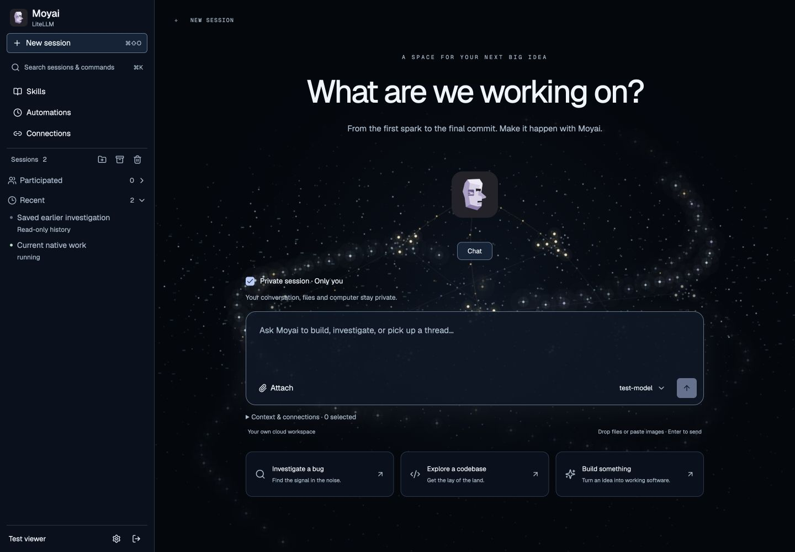

# Moyai

Moyai is a shared AI workspace for coding and connected-service tasks. Chat with
an agent, steer its work, answer questions, inspect its computer, and keep the
resulting files and history. Pydantic AI and Harness provide the agent; Temporal
runs durable execution, Modal or AWS Lambda MicroVMs provide its computer, and LiteLLM supplies models.

The application has one Python installation, one lockfile, and one React frontend.
An existing deployment keeps its users, permissions, historical sessions,
credentials and accounting through the shared product services.

<picture>
  <source media="(prefers-color-scheme: light)" srcset="docs/assets/native/home-light.png">
  
</picture>

*The current composer, captured at 2× resolution in light and dark mode. Account,
model, and session data are synthetic; the task is an unsent demo draft.*

## Quickstart

Try Moyai on your laptop with Docker, or deploy it on a server so it stays
available when your laptop is off. The local quickstart manages SQLite, encrypted
file storage and a local Temporal development server automatically. You only
need a model gateway, an enabled Responses-capable model, and Modal credentials.
Agents execute in Modal computers; Docker hosts the Moyai application.

For AWS ARM64 computers, follow the [native Lambda MicroVM setup](docs/aws-lambda-microvms.md).
Modal remains the default for the quickstart below.

### Option 1: Try locally with Docker

**Prerequisites:** Docker Desktop on macOS/Windows, or Docker Engine with Docker
Compose on Linux. The commands below use a macOS/Linux shell or WSL.

Create `moyai.env` in your working directory and replace the placeholders:

```dotenv
WORKSPACE_PASSWORD=replace-with-a-long-private-password
LITELLM_API_BASE=https://your-gateway.example.com/v1
LITELLM_API_KEY=YOUR_MODEL_KEY
AGENT_MODEL=YOUR_RESPONSES_MODEL
MODAL_TOKEN_ID=YOUR_MODAL_TOKEN_ID
MODAL_TOKEN_SECRET=YOUR_MODAL_TOKEN_SECRET
```

Start the image with persistent local data:

```sh
docker run -d --name moyai --init --restart unless-stopped \
  --stop-timeout 90 \
  --env-file ./moyai.env \
  -p 127.0.0.1:8787:8787 \
  -v moyai-data:/data \
  ghcr.io/berriai/moyai:quickstart \
  moyai dev --host 0.0.0.0 --port 8787
```

The `quickstart` image is built from main for AMD64 and ARM64 after the Docker
startup checks pass. If it is not yet publicly available, use the checkout
fallback below. See [image publication](deploy/docker/README.md#publish-the-quickstart-image)
for release status and maintainer setup.

Open <http://127.0.0.1:8787> and sign in as `admin` with `WORKSPACE_PASSWORD`.
The first start may download Temporal and build the Modal computer image.
Model and computer usage are billed by those providers.

Try: “Create `/workspace/hello.py` that prints Hello from Moyai, run it, and save
it for download.” The chat should show the observed output and a downloadable
file. Follow up in the same conversation to change it.

Use `docker logs -f moyai` to inspect startup and `docker stop moyai` /
`docker start moyai` to stop and start it. Keep the `moyai-data` volume to retain
history, files and encryption keys. This is a local trial; use Option 2 for a
team deployment with managed storage and durable Temporal.

**Checkout fallback:** if you cannot pull the prebuilt image, build it locally
with Git and Docker, keeping `moyai.env` in your current directory:

```sh
git clone https://github.com/BerriAI/moyai.git
docker build --build-arg MOYAI_BUILD_SHA="$(git -C moyai rev-parse HEAD)" \
  -t moyai-local ./moyai
```

Then replace `ghcr.io/berriai/moyai:quickstart` with `moyai-local` in the run command
above. From an existing checkout, you can alternatively copy `.env.example` to
`.env`, fill in the same credentials, and run `docker compose up --build`.

### Option 2: Deploy for your team

Use the [Docker installation guide](deploy/docker/README.md) for a persistent
server deployment. Bring PostgreSQL, private S3-compatible storage, a reachable
HTTPS origin, and the model/Modal settings above. The guide includes a complete
environment example and instructions to obtain a release bundle or build one
from a checkout.

From the deployment directory, with the required settings exported:

```sh
sh moyai.sh up
```

Choose the topology and Temporal option before the first startup:

| Setting | Behavior |
| --- | --- |
| `MOYAI_INSTALL_TOPOLOGY=standalone` | One application container with an embedded worker and dispatcher; this is the default. |
| `MOYAI_INSTALL_TOPOLOGY=split` | API, coordinator, broker and worker as four containers using the same image. |
| `MOYAI_TEMPORAL_MODE=external` | Connect to Temporal Cloud or your existing server using its address, namespace and TLS/API-key settings. |
| `MOYAI_TEMPORAL_MODE=bundled` | Start the included persistent Temporal server and database; setup generates the internal database password. |

The helper configures the installation, checks dependencies, prepares schemas,
retains generated keys, starts the selected services and waits for activation.
Use `sh moyai.sh password` to retrieve a generated sign-in password and
`sh moyai.sh status` to check readiness. A real file task separately verifies
model and computer access.

Keep the deployment configuration and persistent volumes, and keep credentials
exported for later starts. Existing installations must use the documented
[migration and upgrade procedures](deploy/docker/README.md#maintenance-upgrades).
The local quickstart's data is not automatically migrated into this topology.

### Option 3: Develop from source

**Prerequisites:** Python 3.13, Node.js 22 or newer, Rust 1.88 or newer (to build AgentChat), and
[uv](https://docs.astral.sh/uv/getting-started/installation/).

```sh
git clone https://github.com/BerriAI/moyai.git
cd moyai
uv sync --frozen
cp .env.example .env
chmod 600 .env
```

Edit `.env` with your workspace password, model gateway/model and Modal token
pair, then start:

```sh
uv run --frozen moyai dev --port 8787
```

Open <http://127.0.0.1:8787> and sign in as `admin`. This runs the same local
application, worker and Temporal development server. Installation builds the UI
from source. An authenticated local Modal CLI profile also works for source
development. Preserve `.data` and its generated encryption key across restarts.

## Use and operate

- [Using Moyai](docs/usage.md): chat, files, computer control, connections, Settings,
  Slack, approvals and recovery.
- [Swarms](docs/native-swarms.md): persistent teams, shared findings, independent
  member computers, and durable Pause/Resume/time controls on Pydantic AI.
- [Architecture](docs/architecture.md): how requests move through the system and
  which data belongs to each service.
- [Full Linux computers](docs/modal-runtime.md): select Modal's VM runtime for
  Chromium/WebRTC and other workloads that need a full Linux kernel.
- [Docker installation](deploy/docker/README.md): self-hosted installation and upgrades.
- Managed deployment workflows and runbooks are maintained in a private repository.
- [Verification](docs/verification.md): tests, packaging and Docker checks.
- [Consolidation scope](docs/consolidation.md): retired code, preserved contracts
  and features that remain deferred.
- [Documentation index](docs/README.md).

## Develop

```sh
uv run --frozen pytest -q tests
uv run --frozen pytest -q native/tests
uv run --frozen --directory native ruff check src tests
uv run --frozen --directory native pyright
npm run typecheck
npm test
npm run test:ui
```

Install Chromium once with `npx playwright install chromium`. PostgreSQL tests
need a disposable local database; see the verification guide. Build frontend changes with `npm run build`. The generated
`native/src/moyai/static` directory is ignored by Git and included by the package build.
The Python image serves those assets without Node.js.
