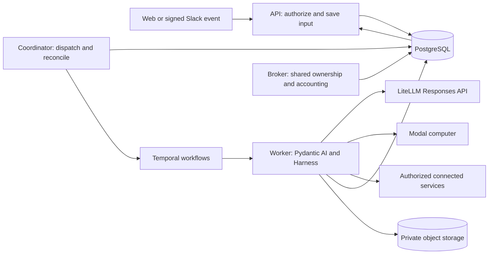

# Architecture and execution

Moyai composes Pydantic AI **2.55.0**, Harness **0.55.0**, Temporal, Modal and
LiteLLM. Versions are pinned in the root `uv.lock`. The application supplies
identity, authorization, admission, presentation, accounting and storage policy.

## A turn

1. The API checks current identity, conversation visibility and account grants,
   then records input with a deduplication identity. Queued input remains durable.
2. The coordinator starts or signals the conversation's Temporal workflow. Temporal
   alone resumes active execution; a snapshot reader never starts a second agent.
3. The workflow uses the SDK's public iterator. Harness supplies coding, planning,
   skills, memory, compaction, questions and delegation. New workflows route model,
   computer and control activities onto separate queues without changing old histories.
4. Activities recheck authority. An approved tool cannot restore a revoked grant.
   Unknown external effects retain durable receipts; automatic retry cannot silently
   repeat an uncertain write. Credentials remain on trusted host services.
5. Accepted answers and deferred questions are saved before the computer snapshot
   settles. The UI receives events and reads durable state. Saved outputs survive
   the live computer; eligible cold continuations restore verified filesystem images.

`native/src/moyai/agent.py` composes the agent; `workflow.py` owns the workflow
adapter, and `worker.py` registers it. `product_*` modules adapt canonical product
services. `app/` contains those shared services and historical data formats.

## Connector execution and answer settlement

`product_connector_execution.py` owns canonical connection execution: worker
threads, transport locks, request authorization and cancellation draining. Native
authorization checks run on the calling event loop. Connection tools, GitHub
publication/bootstrap and Slack file ingress use this module. Read results can
require a fresh grant check after the request; confirmed writes retain their
evidence even when authority changes during the request.

`answer_settlement.py` owns result acceptance, checkpoint capture/publication and
completion after failure or Stop. Its snapshot adapter keeps Modal calls outside
database transactions and lets tests control capture through the same interface.
Publication checks current authority and the exact checkpoint source under the
existing locks. `Database` and Temporal activities forward settlement calls;
`workspace_recovery.py` owns checkpoint formats, validation and cold restoration.
Activity identities, ordering and historical snapshot formats remain compatible.

## Roles and data

Production retains API, coordinator, broker and worker roles. They use the same
image and environment installation, but own different leases and responsibilities.
Startup verifies role contracts and current database ownership. The release
controller retires all source owners before publishing incompatible contracts.

The existing product keeps its canonical PostgreSQL schema, identities, sessions,
permissions, accounting and original encryption key. Native execution uses a
separate explicitly provisioned schema, key, object prefix and Temporal queue.
Historical records and original objects remain readable. Old workflow histories
stay on their original queues; they are not rewritten into native executions.

A local trial has its own SQLite accounts and data, plus a local Temporal server.
That configuration exists for first use and development. It cannot accidentally
bootstrap replacement users inside an existing product installation.

The frontend is `native/web`, using `frontend/components/ui` and `frontend/theme.css`.
Its generated build is served from `native/src/moyai/static`. The wheel includes
both the runtime and shared `app` package, so it works outside this checkout.

See [deployment](pydantic-deployment.md) for the exact ownership and migration
contracts, [usage](usage.md) for supported behavior, and [scope](consolidation.md)
for deferred features.
