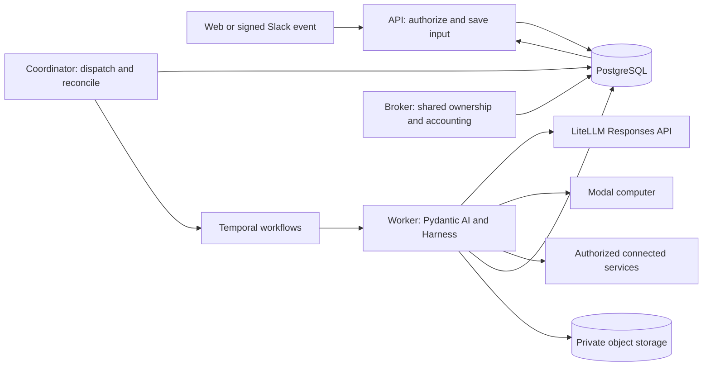

# Architecture and execution

Moyai composes Pydantic AI **2.55.0**, Harness **0.55.0**, Temporal, Modal and
LiteLLM. Versions are pinned in the root `uv.lock`. The application supplies
identity, authorization, admission, presentation, accounting and storage policy.

## A turn

1. The API checks current identity, conversation visibility and account grants,
   then records input with a deduplication identity. Queued input remains durable.
2. The coordinator starts or signals the conversation's Temporal workflow. Temporal
   alone resumes active execution; a snapshot reader never starts a second agent.
3. The workflow uses the SDK's public iterator. Harness supplies coding, planning,
   skills, memory, compaction, questions and delegation. New workflows route model,
   computer and control activities onto separate queues without changing old histories.
4. Activities recheck authority. An approved tool cannot restore a revoked grant.
   Unknown external effects retain durable receipts; automatic retry cannot silently
   repeat an uncertain write. Credentials remain on trusted host services.
5. Accepted answers and deferred questions are saved before the computer snapshot
   settles. The UI receives events and reads durable state. Saved outputs survive
   the live computer; eligible cold continuations restore verified filesystem images.

`native/src/moyai/agent.py` composes the agent; `workflow.py` owns the workflow
adapter, and `worker.py` registers it. `product_*` modules adapt canonical product
services. `app/` contains those shared services and historical data formats.

## Session reads

`session_reads.py` owns native session detail, progress, saved activity, action
details and failure details. Its `SessionReads` interface takes the authenticated
request and user, then returns the existing typed response. It keeps selective
checkpoint loading, requester-only diagnostics, delegated-action scope and
post-read authorization together. Rechecks retain native user version, product
grant and session audience order, after the read transaction has closed.

`api.py` binds these operations to HTTP and owns authentication, middleware and
process lifespan. `api_views.py` holds their wire models and the shared session
and turn projections used by mutation receipts. Session inventory and paged
history remain in `product_routes.py`; reads never admit or resume execution.

## Turn admission

`turn_admission.py` owns `TurnAdmission.submit` and `prepare`: input validation,
request fingerprints, duplicate detection, user/session fences, generated-input
provenance, attachment reservation and the authorized preparation checkpoint.
The HTTP send handler and preparation activities use `Runtime.admission`.
The module takes the existing `Database` as its persistence and policy dependency,
without a Runtime or model. It reads that dependency's current session factory and
product adapters on each operation, including after startup installs role authority.

Generated input requires the caller's native transaction. The caller keeps its
occurrence receipt, turn and commit/rollback together; admission never recovers a
conflict in a separate transaction. Product authority still precedes the user,
swarm and session fences. Audience prefetch stays outside an owned transaction;
final authorization and the commit-bound dispatch notification stay inside it.

All callers, including automations, Slack, historical continuation, delegation,
swarms, goals and their tests, use `database.admission` or `Runtime.admission`.
`Database` no longer forwards `submit` or `prepare`; admission has one interface.
Session creation, authority helpers, continuation/resume and dispatch remain on
Database; answer settlement and read projections keep their existing owners.

## Connector execution and answer settlement

`product_connector_execution.py` owns canonical connection execution: worker
threads, transport locks, request authorization and cancellation draining. Native
authorization checks run on the calling event loop. Connection tools, GitHub
publication/bootstrap and Slack file ingress use this module. Read results can
require a fresh grant check after the request; confirmed writes retain their
evidence even when authority changes during the request.

`repository_preparation.py` owns durable checkout receipts for GitHub and GitLab:
reservation, frozen commit identity, encrypted bundle storage and confirmation.
The provider adapters keep repository validation, authorization rechecks, Git
transport and sandbox installation. Existing receipt identities and lock order
are preserved, so retries can resume preparations created by either revision.

`publication_journal.py` owns the shared publication authorization and preflight
refusal transition. The provider adapters retain operation identities, request
policies and write dispatch. Refusal takes the same operation/effect locks as
dispatch and cannot make a partially written operation retryable. GitLab also
protects its durable stack projection when final acknowledgement is interrupted.

`answer_settlement.py` owns result acceptance, checkpoint capture/publication and
completion after failure or Stop. Its snapshot adapter keeps Modal calls outside
database transactions and lets tests control capture through the same interface.
Publication checks current authority and the exact checkpoint source under the
existing locks. `Database` and Temporal activities forward settlement calls;
`workspace_recovery.py` owns checkpoint formats, validation and cold restoration.
Activity identities, ordering and historical snapshot formats remain compatible.

## Backend feature ownership

`moyai.preferences` owns user-facing Settings, its wire and persistence models,
composer defaults and standalone automation integration. Root `settings.py`
continues to own process configuration. `moyai.reporting` owns analytics and
timing projections; `moyai.billing` owns canonical accounting and ledger
maintenance. Their package initializers perform no imports or I/O, and callers
import individual interfaces. The existing billing maintenance command remains
available as `python -m moyai.billing_storage`.

The feature guides map responsibilities to existing test suites.
`test_feature_packages.py` prevents eager package initialization and keeps
arithmetic and model modules independent of command composition.

`moyai.automations` co-locates product automation commands, schedule
reconciliation, access, event ingestion, tools and persistence models.
`moyai.continuations` co-locates historical handoff, HTTP bindings, workspace
collection/restoration, its guest script and records. Their initializers do not
register or load execution. Model registration uses qualified package paths;
the migration registries, frozen expansions, Temporal identities, canonical
`app` package and historical formats retain their existing values.

## Runtime roles and data

Production retains API, coordinator, broker and worker roles. They use the same
image and environment installation, but own different leases and responsibilities.
Startup verifies role contracts and current database ownership. The release
controller retires all source owners before publishing incompatible contracts.

The existing product keeps its canonical PostgreSQL schema, identities, sessions,
permissions, accounting and original encryption key. Native execution uses a
separate explicitly provisioned schema, key, object prefix and Temporal queue.
Historical records and original objects remain readable. Old workflow histories
stay on their original queues; they are not rewritten into native executions.

A local trial has its own SQLite accounts and data, plus a local Temporal server.
That configuration exists for first use and development. It cannot accidentally
bootstrap replacement users inside an existing product installation.

The frontend is `native/web`, using `frontend/components/ui` and `frontend/theme.css`.
Its generated build is served from `native/src/moyai/static`. The wheel includes
both the runtime and shared `app` package, so it works outside this checkout.

`native/web/conversations` owns conversation state: inventory, history/live
lifecycle, pending session edits and work progress. Renderers consume its
individual files; state does not import renderers, and shared transport does not
import features. The [conversation module guide](../native/web/conversations/README.md)
maps interfaces to their responsibilities and documents the import rules enforced
by `tests/conversations`.

`native/web/automations` owns the saved product automation editor, review,
history presentation and validation. Settings imports its page and UTC date
helpers; it retains navigation and the existing lazy entrypoint.
The [automation module guide](../native/web/automations/README.md) documents
these interfaces and the import rules enforced by `tests/automations`,
including JavaScript helpers and their declarations. Shared controls and
transport do not import automations.

`native/web/history` owns historical conversation rendering, file previews,
continuation review and original-link routing. Its route helpers derive their
types from generated history contracts and remain separate from the lazy
renderer. The [history module guide](../native/web/history/README.md) documents
these interfaces and the import rules enforced by `tests/history`.
Shared transport and presentation do not import history.

`native/web/settings` owns Settings navigation and capability-aware forms.
`native/web/analytics` owns report loading, arithmetic, charts and timing views.
Settings composes analytics and automations through their existing interfaces;
the application retains the Settings lazy entrypoint. Their module guides and
`tests/settings` / `tests/analytics` document and enforce this dependency
direction, including JavaScript helpers and declarations.

`native/web/workspace` owns resource and side-panel rendering, including the
lazy computer panel. `native/web/navigation` owns the sidebar, palette and
session actions. `native/web/messages` owns message rendering and input.
Conversation state remains independent of these renderers. Their module guides
list the existing cross-feature interfaces; `tests/test_native_feature_imports.cjs`
keeps application composition out of those modules and prevents shared
transport/controls from importing features.

The remaining root files are application composition (`main.tsx`, `home.tsx`),
branding/appearance, build entrypoints and shared transport/file helpers.
There are no feature barrels. Consolidation retains direct imports and the
existing lazy-loading behavior.

See [deployment](pydantic-deployment.md) for the exact ownership and migration
contracts, [usage](usage.md) for supported behavior, and [scope](consolidation.md)
for deferred features.
