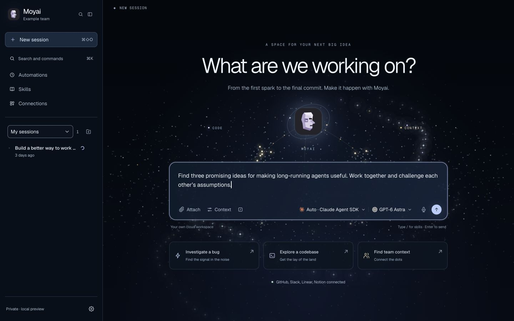
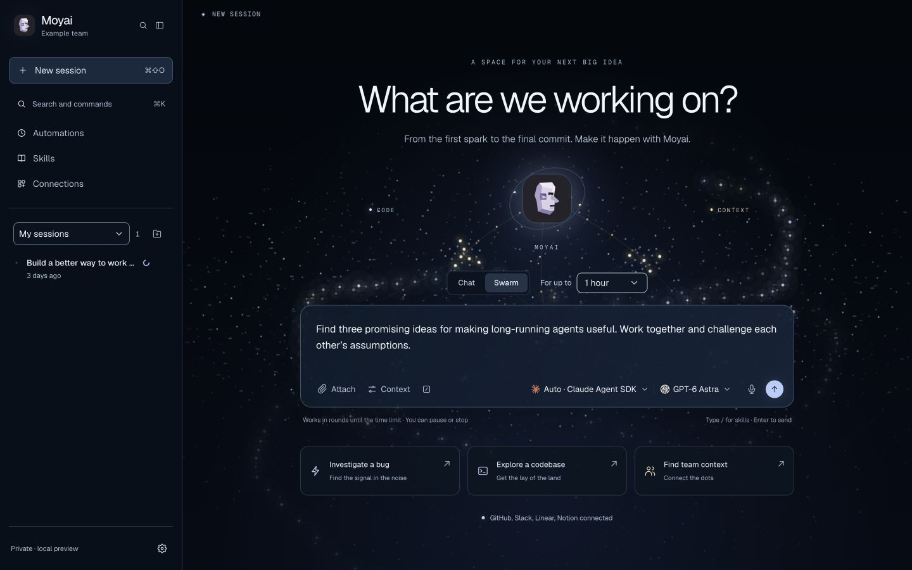
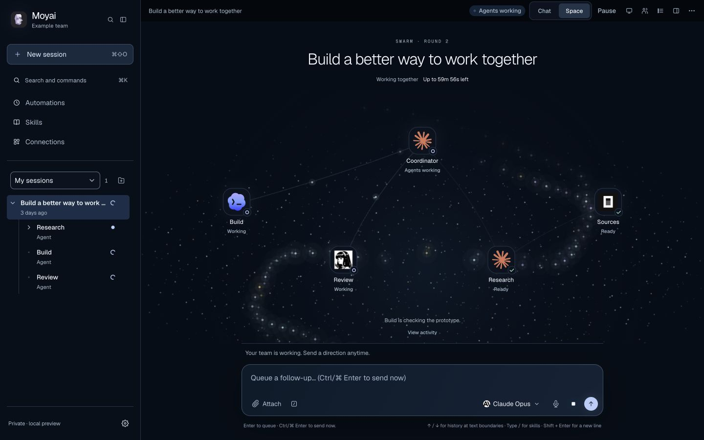

# Swarm mode

Choose **Swarm**, describe a task, and choose a duration or **Until stopped** (the default). Moyai immediately queues 20 real child agents with the same shared goal. Members volunteer to lead, divide the work through a durable board, and publish findings; the coordinator gathers their saved outputs into a useful result. Harnesses are assigned in a randomized, balanced rotation across the configured runtime/model pairs. Each worker receives the complete original task, initial uploads, enabled apps, and the existing permission rules. The activity view shows actual launches, handoffs, tools, and messages; queued workers are not presented as running before they acquire capacity.

Swarm mode requires the existing cloud sandbox setup and Temporal execution. It uses Moyai's durable sessions, saved conversation/workspace checkpoints, delegation tools, and permission boundaries. It is not an independent background loop or a Hermes `/goal` command.

The swarm belongs to its coordinator agent. Shared planning, prompts and the typed `AgentSwarm` Python interface live in [`agent/swarm`](../agent/swarm/README.md); the app supplies persistence, scheduling and visualization. Python integrations and model-facing delegation tools use the same request contracts and durable coordinator.

Set `MAX_PARALLEL_AGENTS` to at least 20. `MAX_CONCURRENT_RUNS` and `MAX_CONCURRENT_MODEL_REQUESTS` still bound actual execution; a smaller capacity queues the rest of the team. Set `SWARM_MODELS` to a comma-separated list of enabled models allowed for automatic worker selection (for example `anthropic/claude-opus-5-5,openai/gpt-6.1-sol`). When unset, workers inherit the selected coordinator model. Claude Agent SDK and Codex prefer their native provider when that provider is in the list. Model choices must still pass the workspace's normal validation. This is diverse assignment, not a quality-routing claim. The initial team is pinned on creation and is never rerolled by HTTP retries or a worker restart.

The coordinator waits without a sandbox while the initial team works, then receives their actual saved answers and can read their artifacts. Follow-up rounds can request additional focused work without creating another automatic 20-agent team. Initial uploads use independent, authorized attachment records; these copies count against the workspace attachment-storage limit. Creation rejects the entire mission if worker admission, model selection, or upload capacity fails.

After a confirmed, checkpointed answer, the host waits 30 seconds using a durable timer, then schedules another round while the swarm is active. Automatically generated messages are marked as swarm continuations. A human message takes priority over a continuation that has not started. Agent context retains the original task, prior results, and human directions.

A swarm has no automatic expiry by default. An optional duration can range from one minute to 30 days and includes queuing, startup, delegated work, and pauses. It is a resumable work window: when it ends, the host pauses current execution and preserves the same mission. There is no round-count limit. Broker admission checks the current root window for new model, tool, compaction, and steering work, even while an execution worker is offline. Authenticated journal receipts, native checkpoints, and acknowledgments of already-delivered steering may still be saved while the same execution capability and turn remain valid; these state-only paths cannot start new inference or tool work. A provider call or external action already admitted may still finish; changing or ending a window does not undo it. Existing checkpoint and machine-rotation behavior continues across hours and days. Failed or uncertain work and repeated identical answers can still require human direction; a duration does not authorize replaying external actions.

**Pause** and **Stop** cancel current execution and preserve saved work. After cleanup, **Resume**, a new message, or a duration change continues the same mission. Resuming a past finite window renews its prior duration; resuming before its deadline preserves remaining time. Duration changes take effect on work launched by this version without an obsolete sandbox timer killing the extended run. Processes already running from an older release can still carry that release’s fixed cutoff; changing the saved duration cannot replace an in-process legacy timer. After an old process stops and its work is saved, resume the same conversation to use the renewable policy. The deployment does not force-restart those processes. Say “go two more hours,” “work for three days,” or “keep going until I stop you” in the coordinator chat to change its time. Only authenticated human root messages can change time; peer posts, tools, worker chats, and generated continuations cannot extend it. Failed children are not automatically replayed. Normal app approvals still apply.

The API accepts `swarm: {}` or `swarm: {"budget_seconds": 0}` for **Until stopped**, and `swarm: {"budget_seconds": 300}` for a finite window on `POST /api/runs` (60–2,592,000 seconds). An unlimited mission stores `ends_at` as an empty string. `PATCH /api/runs/{id}/swarm/time` accepts `{"budget_seconds": ...}` to change the current window. Run details include `swarm.status`, `budget_seconds`, `ends_at`, `round`, and `reason`. Controls are `POST /api/runs/{id}/swarm/pause`, `POST /api/runs/{id}/swarm/resume`, and the existing `POST /api/runs/{id}/cancel`. They require normal authentication and mutation protection. Creation, mission intent, the initial message, all 20 workers, their group, and all durable dispatch wakes commit atomically; continuation messages, round advancement, and their dispatch wake do likewise.

Schema revision 5 adds `swarm_missions` and pinned per-worker runtime assignments; revision 6 adds the durable shared board and peer assignments. For deployments using explicit PostgreSQL migrations, stop runtime owners and run the existing offline migration before starting this version. This feature does not deploy or migrate an existing production installation automatically.

Unlimited windows require runtime protocol revision 5 across the API, coordinator, worker, and broker. Older revisions cannot read an empty deadline. During a staged upgrade, retire the old worker and broker before exposing the new coordinator or API; an API-only or rolling deployment across this protocol boundary is not compatible. Do not roll back to an older protocol after creating unlimited missions.

## Interface preview

These are actual browser captures of the production frontend against synthetic local fixtures. They demonstrate the interface, not live model execution. The creation comparison uses the same sample data and a 1440 × 900 viewport.

| Before | Swarm mode |
| --- | --- |
|  |  |

[Mobile view at 320px](assets/swarm-mode-mobile.jpg). The interface was also checked at 768px, including draft preservation between Chat and Space, child conversations and model identity, duration selection, Pause/Resume/Stop, keyboard focus, and saved-session recovery controls. Reduced-motion behavior is covered by the canvas implementation; a screen-reader audit was not performed.

To inspect the same sample locally, run `npm run preview -- --port 8840` and open `http://127.0.0.1:8840/?fixture=swarm#run=aaaaaaaaaaaaaaaaaaaaaaaaaaaaaaaa`. Alternate fixtures are `swarm-paused`, `swarm-expired`, and `swarm-error`.

## Shared-goal API

`await agentswarm.start(task="Explore this idea", agents=[Agent(), Agent()])` is the primary internal API. Participants optionally select a typed `Harness`, name and model. Callers do not manage request keys or per-agent jobs. See [AgentSwarm](../agent/swarm/README.md) for the owner-bound interface, leadership semantics, durable results, and the separate advanced explicit-delegation API.
